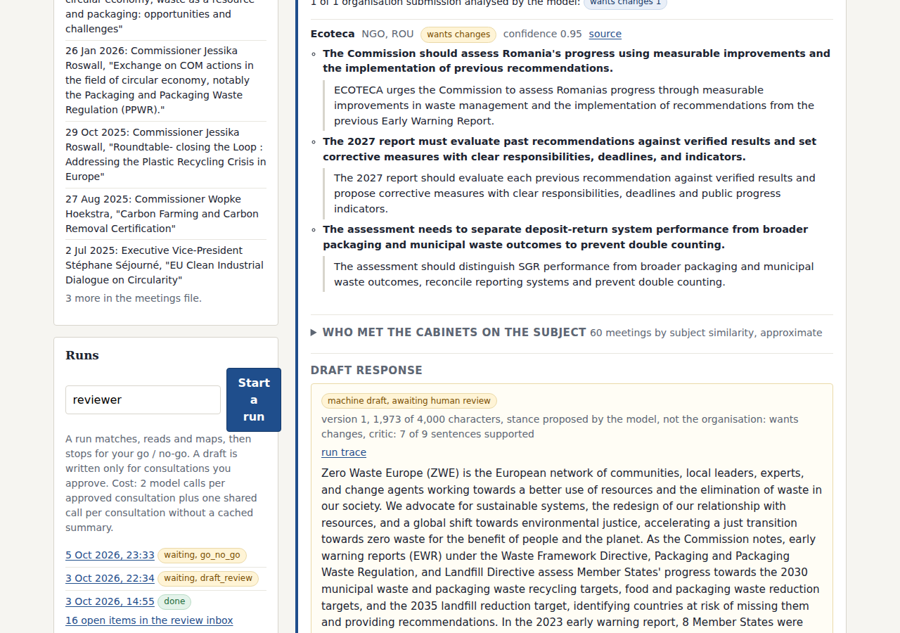
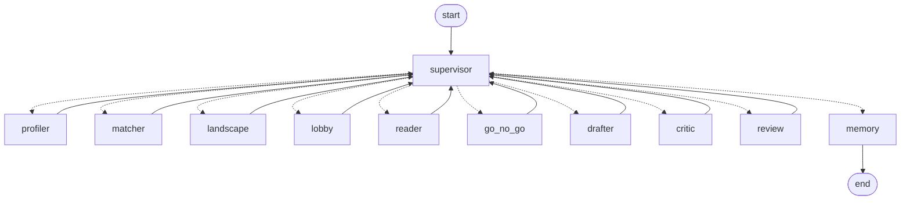
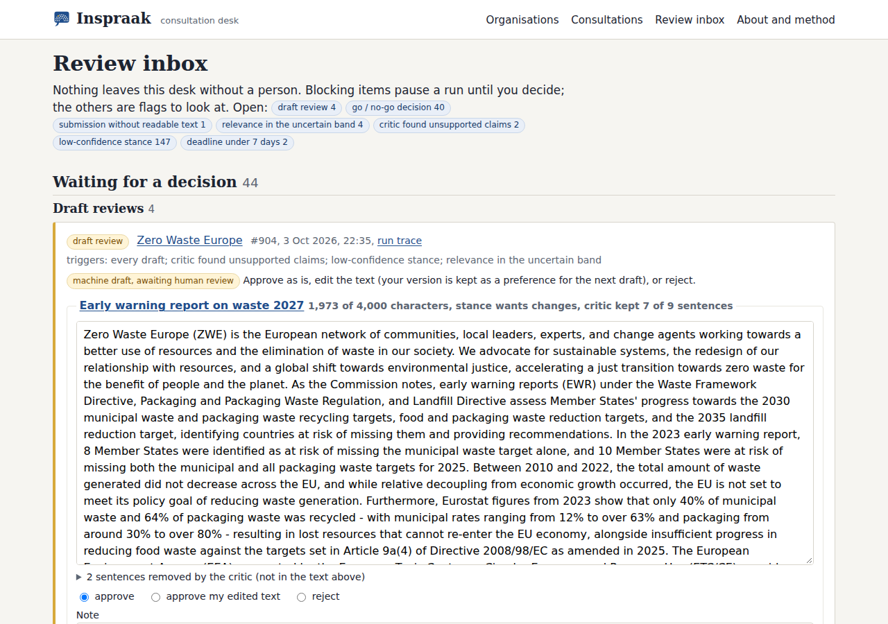
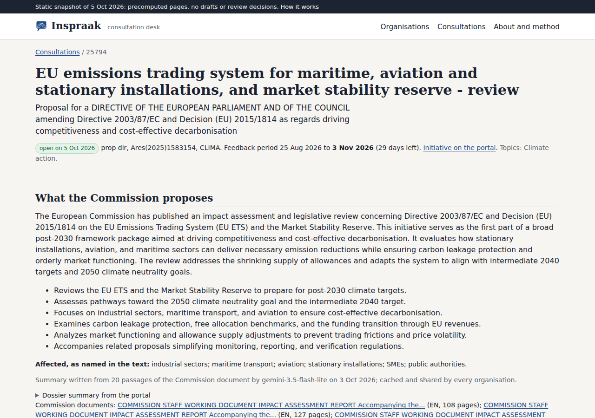
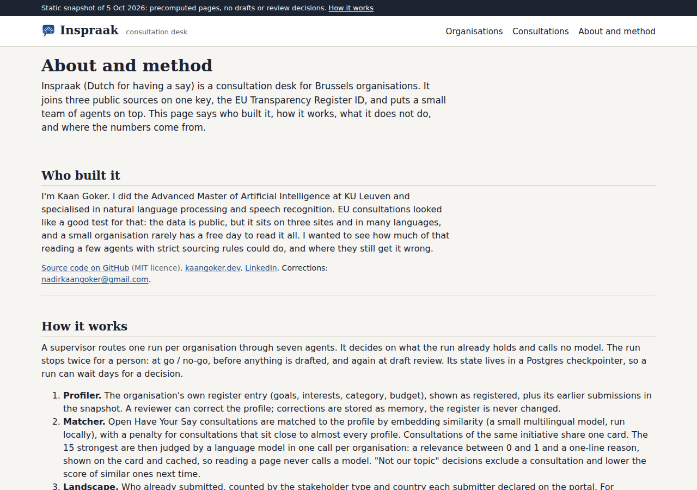

<p align="center"></p>

# Inspraak

Type the name of a Brussels organisation and get one page: the open European Commission consultations that fit it, who already answered, who met the cabinets on the subject, and what the proposal says, with every number linked to its public source.

**Live demo:** [kaangoker.github.io/inspraak](https://kaangoker.github.io/inspraak/), a static snapshot of 5 October 2026 (no drafts, no review decisions).

Built by [Kaan Goker](https://kaangoker.dev) ([LinkedIn](https://linkedin.com/in/kaangoker)). Not affiliated with any organisation it shows.

"Inspraak" is Dutch for having a say. The Commission's Have Your Say portal, the Transparency Register and the Commission meeting lists are three separate sites. This project joins them on a local Postgres snapshot, so a small organisation can see in a minute what a public affairs team would spend a day collecting.


## Features

- **One page per organisation.** The profile as the EU Transparency Register states it (goals, interests, category), correctable by a reviewer. Below it the open consultations that match, one card per initiative, each with a one-line reason why it fits, and a draft on top when there is one.
- **Who already answered.** Submissions per consultation, counted by stakeholder type and country, with verbatim quotes and up to three key asks per organisation submission. Every quote is checked against the source text and dropped when it is not found word for word.
- **Who met the cabinets.** Commission meetings on a similar subject, counted by register category. The match is by subject similarity, so the page says "subject match, approximate" and shows the raw subject line of each row.
- **What the proposal says.** The passages of the Commission document closest to the organisation's profile, each cited to a document and a page.
- **A draft that a human approves.** Up to 4,000 characters, the Have Your Say limit. It is written only after a go decision and checked sentence by sentence by a critic: a fact needs a Commission passage, a position ("we support", "the Commission must") needs the organisation's own past submission or register goals, and anything else is removed. Nothing is ever submitted by the system.
- **A review inbox.** Go or no-go, approve, edit, reject, "not our topic" (which reweights the matcher), and stance corrections. Drafts come first.
- **A run trace.** Every agent step, tool call, token count, cache hit and duration is stored and readable.
- **A public static export.** `inspraak export` writes the precomputed pages as plain files with relative links, so they serve from any sub-path (GitHub Pages included). The public pages leave out what belongs to the people using the app: drafts, go / no-go decisions, review notes, model confidence numbers and every run step after the pause for the human decision. Deadlines are dates with a countdown worked out in the reader's browser, so a page read weeks later still says "closed" at the right time. Organisation pages carry a robots noindex for now.



## Design notes

Two layers sit on one Postgres snapshot.

The **publication layer** runs once per consultation and is shared by every organisation. It writes one summary per publication, one analysis per organisation submission, and a meetings map that uses no model at all. All of it is cached forever. A second organisation that matches the same consultation costs zero model calls.

The **organisation layer** runs on request as one LangGraph thread. It stops twice for a human, at go or no-go and at draft review, and the state lives in a Postgres checkpointer, so a run can wait for days and resume in another process.



Choices worth knowing about:

- **Neutral framing.** The page shows counts and quotes. It never calls an organisation an opponent or an ally, and the stakeholder category comes from the register or the feedback record, never from the model.
- **Frugal model use.** The live path uses the Gemini free tier (`gemini-3.5-flash-lite`) behind a shared Redis token bucket. A cold organisation with one go costs 3 calls: one rerank of its 15 strongest candidates, then draft and critic. The rerank is cached per organisation and publication, so page reads never call a model. Embeddings run locally with a small multilingual model, so they use no quota.
- **Matching in three steps.** Embedding similarity with a hub penalty (consultations close to almost every profile lose a little), one card per initiative, and a batched model rerank that returns a relevance and a reason. Without a model the embedding order stands.
- **Batch providers for the backfill.** Two command line providers handle bulk work: `agy` (Antigravity CLI, Gemini Flash, with a fallback chain of models) and `claude_cli` (the Claude Code CLI, Haiku at low effort). The batch job puts 10 submissions into one call; each answer must echo the opening words of its own submission, or it is discarded and that submission goes through a single call instead.
- **Runs without a key.** `LLM_PROVIDER=fake` is a deterministic stub. The whole system and the full test suite run on it. An `anthropic` API provider exists but was not exercised.
- **Privacy guard.** Names are dropped from every feedback row. Rows from EU and non-EU citizens are counted and nothing else of them is stored; a database constraint refuses content on those rows. On the pages, a submitter with no register number that declared itself a micro company is shown as "Micro company, <country>", and digit runs of 8 or more in organisation names (tax numbers) are masked.
- **Request time never touches the live sites.** Pages are computed from the local snapshot.
- **Guarded writes.** Optional `REVIEW_TOKEN` basic auth on the inbox and every POST, a same-origin check, a per-client rate limit, one run in flight per organisation. Postgres, Redis and the app are bound to 127.0.0.1.

More detail in [docs/ARCHITECTURE.md](docs/ARCHITECTURE.md).

## Screenshots

| Home | Review inbox |
| --- | --- |
|  |  |

| Consultation | About and method |
| --- | --- |
|  |  |

The organisation page at phone width:


## Measured results

The figures below come from one file, [docs/eval.json](docs/eval.json), written by `uv run inspraak eval-report --write docs/eval.json` (table counts) plus the hand-measured block it keeps. The about page reads the same file, and a test fails when this README or [docs/EVAL.md](docs/EVAL.md) quotes a different number. Have Your Say and the meeting list were refreshed on 5 October 2026 at 23:30 Brussels time; the register is the export of 2 October. 17,897 registrants and 81 consultations (41 open).

- **Matching precision.** On 30 hand-checked organisation and consultation pairs, 20 of 30 were relevant (67%), up from 17 of 30 (57%) before the rerank; 8 of 9 first places were right. The Europol Regulation, which led lists it did not fit, dropped from 19 of 35 lists to 4. Consultancies and think tanks with every interest ticked still get a mixed list.
- **Recall against real behaviour.** For 1,526 registrants that really answered an in-scope consultation, the one they answered is in their top 5 in 42.5% of cases by embedding alone (random order: 6.7%). On a sample of 150 of them, counting one card per initiative, the hub penalty and the model rerank raise that from 45.3% to 65.1%, and the median rank from 6 to 2.
- **Every organisation submission is processed.** 9,155 rows: 6,531 analysed by a model, 2,624 without readable text (questionnaire answers, scanned attachments), counted and not analysed.
- **Quotes.** 12,633 of 12,845 key-ask quotes were found verbatim in their own submission (98.3%). The other 212 were dropped before storage. By provider: Gemini Flash through agy 99.6%, Gemini API 96.6%, Haiku 94.8%. 1,879 analyses read the Commission's English machine translation of a submission; their quotes carry a "machine translation by the Commission, original in XX" label.
- **Critic.** On the 5 current drafts (version 1 of every draft a reviewer did not reject), 38 of 49 sentences were supported by a retrieved passage or the profile (77.6%). The 11 others were removed and listed on the draft page. These drafts predate the stricter rule for positions described above.
- **Cost.** The whole open scope cost 195 model calls. After that, the brief for 40 organisations cost 0 calls apart from one cached rerank call each (40 through agy), and each draft costs 2.
- **Cache.** 560 of 563 summary reads by runs came from the cache.

The 5 drafts in the local demo are labelled "machine draft, awaiting human review" or "auto-approved for the demo, no human review". Nobody has judged whether an organisation would send them, and none of them is in the public export.

## How to run

You need Docker, Python 3.12 and [uv](https://docs.astral.sh/uv/).

```bash
cp .env.example .env              # LLM_PROVIDER=fake works without a key
make up                           # postgres on 5544, redis on 6390, migrations
make ingest                       # full snapshot, 1 request per second, resumable
make web                          # http://127.0.0.1:8010
```

`docker compose up -d --wait` also starts the app on http://127.0.0.1:8010 (it applies the migrations first; the first start installs the environment into a volume, which takes a few minutes). `docker compose --profile workers up` adds the Celery worker and beat. Without a worker, runs execute inside the request.

The first full ingest downloads about 120 MB for the register and 160 MB for the Commission data, and takes a while because requests are spaced one second apart.

```bash
uv run inspraak ingest hys --skip-closed   # refresh the open consultations (pages older than 20 h)
make precompute                   # publication layer, open consultations first; stops on the daily budget
uv run python scripts/backfill.py agy,claude_cli   # backfill with the CLI providers (needs agy or claude logged in)
make demo                         # brief stage for the 40 organisations in demo_set.csv
make export                       # public static site under site/ (no drafts or decisions)
make test                         # 120 tests (each run gets its own test database)
make lint                         # ruff
```

A run from the command line:

```bash
uv run inspraak org search "BEUC"
uv run inspraak run start 9505781573-45        # stops at go or no-go
uv run inspraak review list
uv run inspraak review decide 10 '{"go": [25981]}'
uv run inspraak run show <run_id>              # trace, drafts, call counts
uv run inspraak llm calls                      # real call counts
```

Set `GEMINI_API_KEY` and `LLM_PROVIDER=gemini` for real model output. Before the app is reachable by anyone else, set `REVIEW_TOKEN` and a real `POSTGRES_PASSWORD`.

## Data sources and limits

- **EU Transparency Register.** The full export, 17,897 registrants, streamed into Postgres. The file declares XML 1.1 with illegal characters, so the loader cleans the stream before a strict parse.
- **Have Your Say.** The portal's own undocumented JSON backend, with no stability promise. Scope: consultations open and closing within 90 days (41) plus 40 recently closed ones with at least 20 organisation submissions. Five very large closed consultations are samples of the earliest 5,000 rows, and the pages say so.
- **Commission meetings with interest representatives.** Mandate 2024 to 2029, 11,531 meetings. Linking a meeting to a consultation is by subject similarity and is approximate. The list stops at the 60 closest meetings.
- **Documents.** Commission documents are parsed per page and chunked so that a citation is always one page.

Limits, stated plainly:

- 778 analyses have a low confidence or an unclear stance. They sit in the review queue and are kept off the pages until a person looks at them.
- Submissions that arrive as a questionnaire answer or an unreadable attachment are counted, not analysed.
- Non-citizen rows keep the organisation name the submitter typed, except unregistered micro companies (shown by size and country). A small or medium firm named after its owner still shows that name; the guard cannot tell a trading name from a person's name.
- There are no CSRF tokens. A same-origin check stands in for them.

Sources, counts and traps: [docs/DATA.md](docs/DATA.md). Build notes: [docs/BUILD_LOG.md](docs/BUILD_LOG.md).

## Project structure

```
inspraak/
  cli.py            the `inspraak` command
  config.py         settings from the environment, Brussels clock
  db.py             connections, pool, SQL migrations
  store.py          read-side queries
  privacy.py        the guard for feedback rows
  pdf.py            document bytes to text per page
  textutil.py       cleaning, page-bound chunking
  embed.py          local embedder (fastembed) and a test stand-in
  embeddings.py     fills the vector columns
  http.py           polite fetcher with retries
  ingest/           register, hys, meetings, documents, raw cache
  llm/              provider interface, gemini, anthropic, fake, token bucket, schemas
  jobs/             publication layer: reader, analyst (quote verification), meetings map
  agents/           the graph: state, nodes, matcher, memory, trace, service API
  queue.py          Celery app, brief queue with position, nightly schedule
  web/              FastAPI app, view models, Jinja2 templates, SVG charts, CSS, htmx
  export.py         static export with relative links
  evaluate.py       the numbers behind docs/EVAL.md
  migrations/       numbered plain SQL files
tests/              parsers on recorded fixtures, provider, jobs, graph with interrupt and resume, web, export
docs/               ARCHITECTURE.md, DATA.md, EVAL.md, BUILD_LOG.md
assets/             screenshots from the running app
demo_set.csv        40 Belgian registrants used for the demo
```

## License

MIT, see [LICENSE](LICENSE). Copyright 2026 Kaan Goker.
