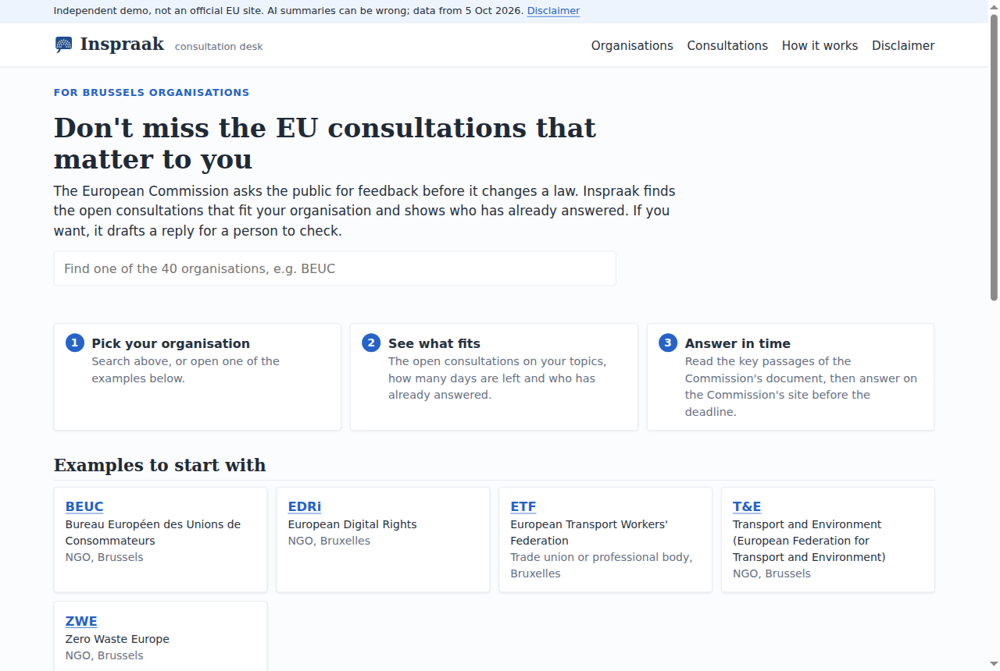
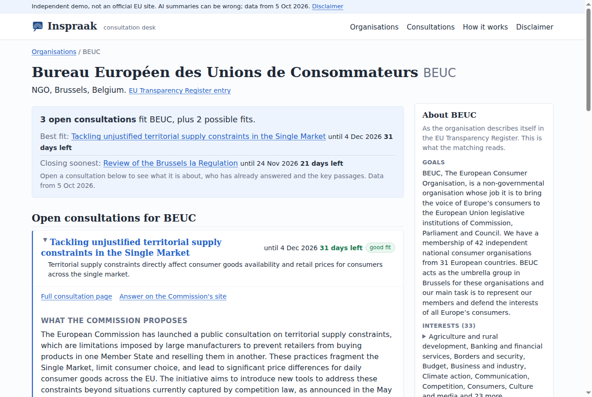
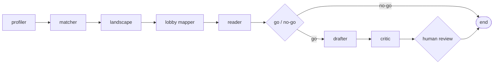
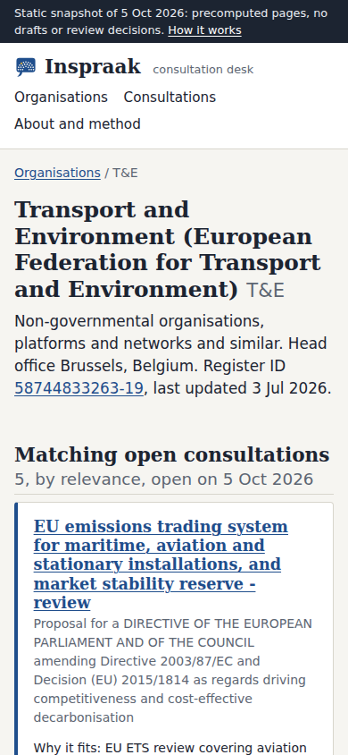

<p align="center"></p>

# Inspraak

[](https://github.com/KaanGoker/inspraak/actions/workflows/ci.yml)
[](pyproject.toml)
[](LICENSE)

Pick an organisation and Inspraak shows the open EU consultations it should answer, who has already answered and what the Commission proposes. A reply is drafted only after a person says go.

**Live demo:** [kaangoker.dev/inspraak](https://kaangoker.dev/inspraak/). 40 Brussels organisations and 81 consultations, data from 5 October 2026. Drafts and review decisions stay in the local app.

> **Disclaimer.** Inspraak is an independent project by one person. It is not made by, for or with the European Commission or any organisation it shows, and those organisations do not use it. Summaries, match reasons and stances are written by AI and can be wrong; the Commission's own page is always the source. Nothing here is legal or policy advice. Full text: [disclaimer page](https://kaangoker.dev/inspraak/disclaimer.html).

<p align="center"> </p>

## Features

- **Consultations that fit.** The open consultations closest to an organisation's register entry, each with a one-line reason and the days left.
- **Who already answered.** Answers counted by stakeholder type and country, with each organisation's stance and up to three key asks. Every quote is checked word for word against the original answer and dropped when it is not found.
- **What the Commission proposes.** An AI summary of the Commission's document and the passages closest to the organisation's topics, each cited to its PDF page.
- **Who met the Commission.** Meetings with Commissioners' teams on a similar subject, from the Commission's own meeting file, marked approximate.
- **A draft only after a yes.** At most 4,000 characters, the portal's limit. A critic removes every sentence it cannot source, and a person reviews the result. Nothing is ever submitted.
- **Citizens stay out.** Citizens who answered are counted. Their names and answers never reach the database, and a constraint refuses them.

## How it works

Three public sources sit in one Postgres snapshot, joined on the Transparency Register ID: the EU Transparency Register (17,897 organisations), Have Your Say (81 consultations in scope) and the Commission's meetings with interest representatives (11,531 meetings).

Work that is the same for every organisation runs once per consultation and is cached: the document summary, one analysis per answer, the meetings map. A second organisation on the same consultation costs no model call.

Each organisation then gets one LangGraph run. A supervisor sends it through the agents and stops twice for a person, at go / no-go and at draft review. The run waits in a Postgres checkpointer, for days if needed.



| Agent | Model calls | What it does |
| --- | --- | --- |
| profiler | 0 | Reads the register entry and the organisation's earlier answers |
| matcher | 0 or 1 | Embedding similarity, then one cached rerank with a relevance and a reason |
| landscape | 0 | Counts, stances and verified quotes from the cache |
| lobby mapper | 0 | Meetings on a similar subject |
| reader | 0 or 1 | The cached summary and the passages closest to the profile, with page numbers |
| go / no-go | 0 | A person decides per consultation |
| drafter | 1 per go | A draft in the organisation's own voice |
| critic | 1 per draft | Keeps a fact only with a Commission passage and a position only with the organisation's own material |
| review | 0 | A person approves, edits or rejects; an edit is kept for the next draft |

The live path uses `gemini-3.5-flash-lite` on the free tier; part of the one-off analysis of answers ran on Claude Haiku (see docs/EVAL.md). `LLM_PROVIDER=fake` is a deterministic stand-in that runs the whole system and the test suite without a key. Details: [docs/ARCHITECTURE.md](docs/ARCHITECTURE.md).

## Measured

Every number comes from [docs/eval.json](docs/eval.json); a test fails when this README quotes a different one.

- **Matching:** 15 of 30 suggested consultations were relevant in a blind test, so the list is a shortlist to check, not a ranking to trust.
- **Quotes:** 12,633 of 12,845 were found word for word in their own answer (98.3%). The other 212 were dropped.
- **Held back:** 778 analyses with low confidence or an unclear stance stay off the pages.
- **Critic:** 38 of 49 draft sentences were supported by a source; the other 11 were removed and listed.

How each one was measured: [docs/EVAL.md](docs/EVAL.md).

<p align="center"></p>

## Run it locally

You need Docker, Python 3.12 and [uv](https://docs.astral.sh/uv/).

```bash
cp .env.example .env    # LLM_PROVIDER=fake works without a key
make demo-local         # containers, a small test snapshot, the app on http://127.0.0.1:8010
```

`make ingest` downloads the full snapshot (about 280 MB, one request per second, a few hours). `make export` writes the public static site to `site/`. `make test` and `make lint` run the tests and ruff. Before anyone else can reach the app, set `REVIEW_TOKEN` and a real `POSTGRES_PASSWORD`.

## Project structure

```
inspraak/
├── inspraak/
│   ├── agents/       LangGraph graph, supervisor, matcher, rerank, memory
│   ├── ingest/       Transparency Register, Have Your Say, meetings, documents
│   ├── llm/          Gemini, command line and fake providers
│   ├── jobs/         publication layer: summaries, analyses, meetings map
│   ├── migrations/   Postgres schema with pgvector
│   ├── web/          FastAPI app, Jinja2 templates, static site styles
│   └── export.py     static export for GitHub Pages
├── docs/             ARCHITECTURE, DATA, EVAL and eval.json
├── scripts/          backfill and evaluation helpers
├── tests/            pytest, one test database per run
└── assets/           screenshots and brand
```

## Data sources

- [EU Transparency Register](https://transparency-register.europa.eu/odplastorganisationxml_en), full XML export, reused under the Commission's reuse notice (Decision 2011/833/EU).
- [Have Your Say](https://ec.europa.eu/info/law/better-regulation/have-your-say_en): consultations, published answers and Commission documents, read through the portal's JSON backend at one request per second into a local snapshot.
- [Commission meetings with interest representatives](https://ec.europa.eu/transparency-initiative/meetings/listcommissioners?collegeid=0), 2024 to 2029 (CC BY 4.0).

All three are © European Union. Inspraak filters, counts, matches and summarizes the data; the original records stay on those sites. Short quotes from published answers link to the full answer. Corrections or removal: nadirkaangoker@gmail.com, handled within 48 hours. Sources and their traps: [docs/DATA.md](docs/DATA.md).

## License

MIT, see [LICENSE](LICENSE). Copyright 2026 Kaan Goker.
