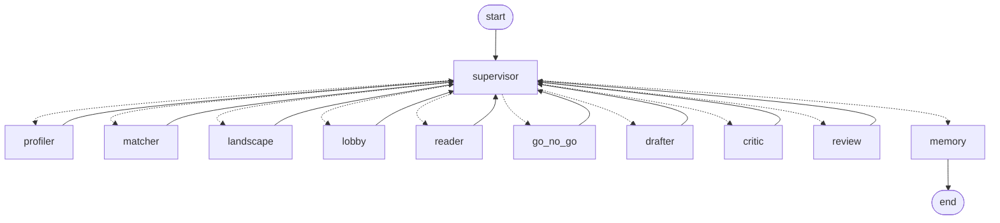

# Architecture

Two layers over one Postgres snapshot. The publication layer runs nightly and is shared by
every organisation; the organisation layer runs on request, one LangGraph thread per run,
and stops twice for a human.

## Design notes

- **Neutral framing.** The pages show counts and quotes. They never call an organisation
  an opponent or an ally, and the stakeholder category comes from the register or the
  feedback record, never from the model. Stance labels read "model reads as".
- **Frugal model use.** The live path uses `gemini-3.5-flash-lite` on the free tier behind
  a Redis token bucket shared by every process (`LLM_RPM`, `LLM_RPD`). A cold organisation
  with one go costs 3 calls: one rerank of its 15 strongest candidates, then draft and
  critic. The rerank is cached per organisation and publication, so page reads never call
  a model. Embeddings run locally with a small multilingual model and use no quota.
- **Matching in three steps.** Embedding similarity with a hub penalty (consultations
  close to almost every profile lose a little), one card per initiative, and a batched
  model rerank that returns a relevance and a reason. Without a model the embedding order
  stands.
- **Batch providers for the backfill.** Two batch providers (Gemini Flash and Claude
  Haiku) handled the one-off backfill of the publication layer. The batch job puts 10
  submissions into one call; each answer must echo the opening words of its own
  submission, or it is discarded and that submission goes through a single call instead.
- **Runs without a key.** `LLM_PROVIDER=fake` is a deterministic stand-in. The whole
  system and the full test suite run on it.
- **Privacy guard.** Names are dropped from every feedback row. Rows from EU and non-EU
  citizens are counted and nothing else of them is stored; a database constraint refuses
  content on those rows. On the pages, a submitter with no register number that declared
  itself a micro company is shown as "Micro company, <country>", and digit runs of 8 or
  more in organisation names (tax numbers) are masked.
- **Request time never touches the live sites.** Pages are computed from the local
  snapshot.
- **Guarded writes.** Optional `REVIEW_TOKEN` basic auth on every page but `/static` and
  `/healthz`, a same-origin check on every POST, a per-client rate limit, one run in
  flight per organisation. Postgres, Redis and the app are bound to 127.0.0.1.

## Project structure

```
inspraak/
  cli.py            the `inspraak` command
  config.py         settings from the environment, Brussels clock
  db.py             connections, pool, SQL migrations
  store.py          read-side queries
  privacy.py        the guard for feedback rows
  pdf.py            document bytes to text per page
  textutil.py       cleaning, page-bound chunking
  embed.py          local embedder (fastembed) and a test stand-in
  embeddings.py     fills the vector columns
  http.py           polite fetcher with retries
  ingest/           register, hys, meetings, documents, raw cache
  llm/              provider interface, gemini, fake, batch providers, token bucket, schemas
  jobs/             publication layer: reader, analyst (quote verification), meetings map
  agents/           the graph: state, nodes, matcher, memory, trace, service API
  queue.py          Celery app, brief queue with position
  web/              FastAPI app, view models, Jinja2 templates, SVG charts, CSS, htmx
  export.py         static export with relative links
  evaluate.py       the numbers behind docs/EVAL.md
  migrations/       numbered plain SQL files
tests/              parsers on recorded fixtures, provider, jobs, graph with interrupt and resume, web, export
docs/               ARCHITECTURE.md, DATA.md, EVAL.md, eval.json, eval/ (precision judge)
assets/             screenshots from the running app, brand files
demo_set.csv        40 Belgian registrants used for the demo
```

## Graph



`uv run inspraak run graph` prints the compiled graph as mermaid.

| Node | Model calls | What it does |
| --- | --- | --- |
| supervisor | 0 | Deterministic routing on what the state already holds (`inspraak/agents/nodes.py`, `route`). Writes a trace row per hop and the run's `stage`. |
| profiler | 0 | Register row plus reviewer corrections from memory (`profile_edit`), past submissions as the voice. |
| matcher | 0 or 1 | Cosine similarity of the profile vector against the open in-scope publication vectors, minus a hub penalty: 0.5 times `publications.hub_score`, the mean cosine of a publication to its 200 nearest registrants, centred on the mean over the scope (`compute_hub_scores`, run at the end of `inspraak embed` or with `inspraak match-calibrate`). `not_our_topic` corrections exclude a publication and demote its close neighbours: the penalty is 0.3 times the part of the similarity that lies above a baseline (mean plus one standard deviation of the corrected publication's similarity to the candidates), scaled to [0, 1], so typical publications lose nothing (`correction_penalty`). Publications of one initiative (or with the same short title) collapse into one card: the one with a draft, else the open one with the nearest deadline, with the best score of the group and the others listed as siblings. The 15 strongest cards are reranked by one batched model call (`agents/rerank.py`, purpose `match_rerank`): the model sees the register profile and each consultation's title and cached summary and returns a relevance in [0, 1] and a one-line reason. Judgments are cached per organisation, publication and profile text (`match_reranks`), so a second run and every page read cost nothing; a profile edit invalidates them. Relevance under 0.3 drops a card, 0.6 and over is the match band, the rest is uncertain (escalation). Without a provider, after a model error or with `MATCH_RERANK=0` the embedding order stands, with the bands from `MATCH_MIN_SCORE` and `MATCH_UNCERTAIN_SCORE`. Deadline under 7 days is an escalation; every deadline check uses Brussels time (`config.portal_now`). |
| landscape | 0 | Reads the `feedback_analyses` cache: counts by type and country, stances, verified quotes. Low-confidence rows are held back and escalated; rows with an attachment that could not be read are escalated. |
| lobby | 0 | `publication_meetings` cache (subject similarity, "approximate") joined to the register for counts by category, plus the organisation's own meetings. |
| reader | 0 or 1 per publication | The cached publication summary (one shared call per publication, ever) and the proposal chunks closest to the profile vector, with page numbers. |
| go_no_go | 0 | `interrupt()`. Writes the blocking review item, pauses in the Postgres checkpointer. Resumes with `{go, no_go, not_our_topic}`. |
| drafter | 1 per go | Draft from profile, past submissions, stored reviewer edits, summary, passages. Hard cut at 4,000 characters. Stance compared with the stored position on the same initiative (conflict escalation). |
| critic | 1 per draft | Every sentence gets one or more of `chunk:<id>`, `submission:<id>` (one of the organisation's past submissions the drafter saw), `profile` or `none`. A citation outside the material shown counts as none. Unsupported sentences are removed and listed; so are sentences with stance wording ("strongly support", "welcomes", "outweighed") that cite only `profile`, because the register profile does not state a position, and normative sentences in the organisation's voice ("we support", "we call for", "must", "should", or a stance verb with the organisation as subject) that cite no organisation source, only Commission passages (`judge_sentence`, `is_normative`; a sentence that reports what the proposal says is exempt). `[chunk:N]` markers are cut from the drafter's text before the critic and from the stored draft (`textutil.strip_chunk_markers`). Courtesy lines are allowed. Escalation when any was removed. The sentence splitter knows abbreviations (Art., No., e.g.). Draft version 1 stored. |
| review | 0 | `interrupt()`. Blocking review item carrying every draft, the critic report and all triggers. Resumes with `{items: {publication_id: {action, text, note}}}`. |
| memory | 0 | `org_memory` rows: go, no_go, not_our_topic, approved, edited, rejected, draft_edit (machine text next to the reviewer's), position. Draft status updated, version 2 stored on an edit. |

A cold organisation with one go costs 3 calls (rerank, drafter, critic), plus one shared call
per matched publication that has no summary yet. The rerank is cached, so a second run of
the same organisation pays only for its drafts. The runs that built the snapshot are listed
under "Runs" in `docs/EVAL.md`.

## Interrupts and resume

`service.start_run` creates the `runs` row and invokes the graph with `thread_id = run_id`.
When a node calls `interrupt()`, `graph.invoke` returns with `__interrupt__`, the run row is
set to `waiting` with the interrupt kind as stage, and the blocking review item is already
in `review_items`. `service.decide(item_id, decision)` marks the item decided and invokes the
graph again with `Command(resume=decision)`; LangGraph re-enters the interrupted node, which
is why the node writes its review item idempotently (one blocking item per run and kind).
The checkpointer is `langgraph-checkpoint-postgres` on the same database (tables
`checkpoints`, `checkpoint_blobs`, `checkpoint_writes`), so a worker process can resume a
run another process started.

`decide` validates the decision before storing anything (a malformed one is refused and the
run keeps waiting). The item is claimed with `UPDATE ... WHERE status = 'open' RETURNING id`,
so a second submit gets `AlreadyDecided` (409 in the web form) and the resume is sent once.
Before a Celery dispatch the run is set to `queued` with stage `resuming`, so its queue
position shows. A failed run continues from its last checkpoint with
`inspraak run retry <id>` (`service.retry_run`). An organisation has at most one queued or
running run.

## Escalation triggers

Into `review_items`, non-blocking unless noted:

| Trigger | Raised by | Kind |
| --- | --- | --- |
| every draft | review node | draft_review (blocking) |
| relevance in the uncertain band | matcher | relevance |
| deadline under 7 days | matcher | deadline |
| critic found unsupported claims | critic | critic |
| low-confidence stance | feedback analyst (publication layer) | stance, decidable: `{stance: ...}` corrects the cached row |
| unparseable attachment (no text, attachments present, none readable) | feedback analyst | attachment; a questionnaire answer with neither text nor attachment is only counted |
| conflict with a stored earlier position | drafter | conflict |

## Tables added by the agent layer (`003_agents.sql`)

`llm_calls` (every model call: provider, model, purpose, tokens, attempts, ok), `publication_summaries`, `feedback_analyses` (stance, confidence, verified key asks, quotes dropped, needs_review), `publication_meetings`, `runs`, `run_traces`, `review_items`, `org_memory`, `drafts`. `004_matching.sql` adds `publications.hub_score` and `match_reranks` (one judgment per organisation, publication and profile hash).

## Model provider

`inspraak/llm`: one interface, `complete_json(prompt, schema, purpose, ...)`, returning a
validated pydantic object. The base class owns the Redis token bucket (`LLM_RPM`,
`LLM_RPD`, `inspraak/llm/bucket.py`, Lua script, in-memory twin for tests), retries with
backoff on 429 and 5xx (5, 15, 30, 60 s), one corrective retry on invalid JSON, the dash
post-filter on every string the model returns, and the `llm_calls` log. When the daily
budget is spent, `QuotaExhausted` is raised and the job stops and reports. Providers:
`gemini` (google-genai, JSON mode with the schema, the live path), `fake` (deterministic,
purpose-aware, used by every test), and two batch providers for the one-off backfill of
the publication layer: `agy` (Gemini Flash, schema in the prompt, a model chain from
`AGY_MODELS` that moves to the next model when one reports its quota spent) and
`claude_cli` (Claude Haiku, model and effort from `CLAUDE_CLI_MODEL` and
`CLAUDE_CLI_EFFORT`). Neither uses the Gemini token bucket.

`inspraak/jobs/batch.py` runs the feedback analyst in parallel threads for those
providers, 10 submissions per call. Each answer must echo the opening words of its own
submission; an answer that does not match its submission's text is discarded and that
submission goes through a single call (`single=True`). The cache wins: a row another
worker stored meanwhile is skipped. `scripts/backfill.py` chains the batched pass, the
single pass and the publication summaries down a provider list (default `agy,claude_cli`).

## Queue

Celery on Redis (`inspraak/queue.py`). Queue `brief`: `run_brief`, `resume_brief`, one task at
a time per worker (`worker_prefetch_multiplier = 1`, `acks_late`), queue position kept in
the Redis list `inspraak:brief:queue` and shown by `get_run`. Queue `nightly`:
`nightly_snapshot` and `precompute_publications`, sent by hand or by an external
scheduler (there is no built-in schedule). The precompute walks the scope in budget order (`jobs.publications_to_precompute`: open
publications by nearest deadline, then the closed ones, most recently closed first), the
analyst's `feedback_limit` caps model calls per publication and pass (rows without readable
text are free and always recorded), and the pass stops cleanly when the daily budget is
spent; the next pass continues from the caches. The model rate limit is the shared token
bucket, not a Celery setting. `RUN_INLINE=1` (tests, CLI)
runs the graph in the calling process; when the broker is unreachable the service falls
back to inline and says so in the `dispatch` field.

## Service API (for the web stage)

`inspraak.agents.service`: `start_run(tr_id, requested_by, options, inline)`,
`get_run(run_id)` (row, trace, review items, drafts, call counts, queue position),
`list_runs`, `list_review_items(status, tr_id, run_id, kind)`, `decide(item_id, decision,
decided_by, inline)`, `edit_profile(tr_id, edits)`, `organisation_memory(tr_id)`,
`llm_call_counts()`, `start_demo(tr_ids, replace)` (one run per listed organisation without one,
used by `inspraak demo` with `demo_set.csv`; `--replace` closes a run that still waits at an
undecided go / no-go and has no draft as `superseded`, with its open review items, and starts
a new one, so the run carries the current match list; nothing is deleted). Evaluation: `inspraak.evaluate.report`
(`inspraak eval-report`). Publication layer: `inspraak.jobs.precompute_publication`,
`inspraak.jobs.reader.get_summary`, `inspraak.jobs.analyst.analyses_for_publication`,
`inspraak.jobs.meetings_map.lobby_picture`.

## Guarding the web app

A middleware in `web/app.py` guards every write. `REVIEW_TOKEN`, when set, puts basic auth on
`/inbox` and every POST. A POST from another origin gets 403 (a same-origin check stands in
for CSRF tokens). `WRITE_RATE_PER_10MIN` (default 20) limits writes per client. Compose binds
the app, Postgres and Redis to 127.0.0.1.

## Web and static export

`inspraak/web/`: `app.py` (FastAPI, `create_app()`), `views.py` (view models, plain dicts,
read-only), `render.py` (one Jinja2 environment for both modes), `links.py` (public source
links), `charts.py` (inline SVG bars), `templates/`, `static/` (`style.css`, vendored
`htmx.min.js` 2.0.4). `inspraak/export.py` renders the same templates in static mode.

Routes: `GET /` (home, search box, stats, precomputed organisations, open consultations by
deadline), `GET /search?q=` (HTMX partial, or a full page without the `HX-Request` header),
`GET /org/{tr_id}`, `GET /consultation/{id}`, `GET /inbox`, `GET /run/{id}`,
`GET /run/{id}/status` (HTMX poll every 3 s while queued or running), `GET /about`,
`GET /healthz`. Actions: `POST /org/{tr_id}/run` (service.start_run, redirect to the run),
`POST /org/{tr_id}/profile` (service.edit_profile), `POST /review/{item_id}`
(service.decide; a blocking item resumes the graph inline or through the brief queue; a
relevance item decided "not our topic" also writes the `not_our_topic` memory row so the
matcher reweights next time; HTMX swaps the item in place, a plain form redirects to the
inbox).

The organisation page is computed on read, no model call: profile plus memory edits,
`matcher.match` with the stored corrections and the cached rerank judgments (matcher order;
a consultation with a draft first, and kept on the page even when the matcher no longer
ranks it), per match the cached
summary, feedback counts and cached analyses, the meeting map (cache, or a read-only
similarity pass when the nightly map has not run for that publication), the chunks closest
to the profile vector with page citations, the latest draft row and its state, and the
go / no-go decision from memory. Everything shown links to its public source
(`links.py`; the meetings portal has no per-row deep link, so meeting rows link to the XLSX
file and the portal listing).

Static export (`inspraak export --out site/`): `index.html` with a client-side search over
`search.json`, `about.html`, `org/<tr_id>.html` for organisations with a run (or `--org`),
`consultation/<id>.html` for every in-scope publication, `run/<id>.html` for the latest
current run of each exported organisation, `static/style.css`, `.nojekyll`. Relative links
through the `u()` helper (`rel` prefix per folder depth), so the site serves from a
sub-path; no HTMX, no forms. The export clears `org/`, `consultation/` and `run/` first so
no stale page survives.

The public pages leave out what belongs to the people using the app
(`export.public_organisation`, `views.public_run` and `static_mode` in the templates):
drafts, go / no-go decisions and who made them, the memory log, review items, cards kept
only because of a draft, stance confidence numbers, and every run step after the pause for
the human go / no-go (the run page shows the brief stage only). Every page carries a slim
snapshot bar, the author credit with links and a correction address in the footer, and
description and Open Graph tags; organisation pages carry `robots: noindex, nofollow`.
Deadlines are written as dates with their Brussels offset (`deadline_iso` filter) and a
small script in `base.html` computes the countdown in the reader's browser, says "closed"
after the date, and hides closed rows from the open list. Quotes taken from the
Commission's English machine translation carry "machine translation by the Commission,
original in XX". Unregistered micro companies show as "Micro company, <country>" and digit
runs of 8 or more in organisation names are masked (`privacy.display_submitter`); a model
"what is asked" line that only says the text asks nothing is dropped (`views.clean_summary`).
The about page reads its evaluation numbers from `docs/eval.json`. At the end of the export
`unlink_missing_pages` turns every link to a page that was not exported into a register link
(organisations) or plain text, so the export has no broken internal links.

`docker-compose.yml`: `api` on 8010 (migrates, then `uv run inspraak web`, healthcheck on `/healthz`,
first start syncs the environment into a named volume), `worker` under the
`workers` profile, each with its own venv volume and a shared uv cache.
